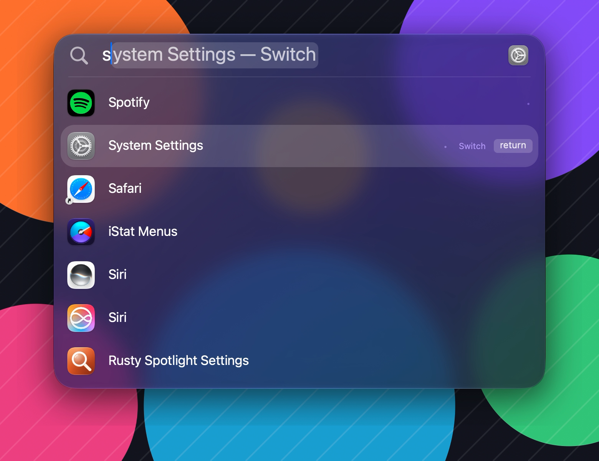

<p align="center"></p>

# Rusty Spotlight

<p align="center"><a href="https://blackkspydo.github.io/rusty-spotlight/"></a></p>

<p align="center"><b><a href="https://blackkspydo.github.io/rusty-spotlight/">▶ Watch the demo (34 s) on the website</a></b><br><sub>Opening spring, the glass taking each app's colours (Spotify, Chrome, Safari, Maps, Photos), the list springing open, a sum, currency, the time in Tokyo, units and Command-K. Recorded live with <code>scripts/record-demo.swift</code>, glass colour at Strong.</sub></p>

A fast Spotlight replacement for macOS, written in Rust. It looks and moves like Spotlight, on the same Liquid Glass, but only searches what you ask it to:

- **Apps:** type a few letters and press Return. It learns which results you pick.
- **Calculator:** `12*7`, `15% of 2400`, `2400 + 18%`.
- **Currency:** `100 usd to inr`, `$100`, `500 aed`. Rates come from Yahoo Finance and work offline from the cache.
- **Units:** `5 km to mi`, `70kg in lb`, `100 f to c`, `6 ft`.
- **World time:** `time in dubai`, `sydney time`, `3pm ist to sydney`.
- **Websites:** `gh rust-lang/rust`, `yt lofi`, or a bare address such as `github.com`.
- **Files and folders** (off until you switch it on): `file notes` lists files and folders by name; `folder notes` lists folders. Names come from the index macOS already keeps.
- **Clipboard history** (off until you switch it on): `clip` shows recent copies, including images and files. Return puts the selected one back on the clipboard.
- **Ask:** `? how do I untar a file` sends the question to an assistant command-line tool on your Mac (Claude Code, Codex or Grok) and shows the answer.
- **System Settings:** `bluetooth`, `night shift`, `text replacements`, `tap to click`, `microphone` open that pane, or that section inside it, directly. Results sit among your apps, each with its pane's icon.
- **Command-K:** shows the selected result's other actions: Show in Finder, Copy Path, Quit, Copy Link, Pin, Delete, ask another tool.

Return copies the answer to a sum, conversion or question, and opens a file or folder. Images in the clipboard history are stored on disk, with a small thumbnail kept for the list.

## Requirements

- **macOS 26 (Tahoe) or later.** The panel is drawn on the system's Liquid Glass, which older versions don't have.
- **Xcode Command Line Tools,** for the linker and `codesign`. Install them with `xcode-select --install`.
- **Rust,** through [rustup](https://rustup.rs). The repository pins the version in `rust-toolchain.toml`; rustup downloads it on the first build.
- About 1 GB of free disk space for the build folder. The installed app is under 2 MB.

## Install

```sh
# 1. Rust, if you don't have it yet
curl --proto '=https' --tlsv1.2 -sSf https://sh.rustup.rs | sh

# 2. The code
git clone https://github.com/blackkspydo/rusty-spotlight.git
cd rusty-spotlight

# 3. Build it, install it, and start it
./scripts/install.sh
```

The first build downloads the dependencies and takes a minute or two. The script then:

- puts **Rusty Spotlight.app** in `/Applications`, signed for this Mac only;
- adds a login item (a LaunchAgent at `~/Library/LaunchAgents/local.rusty-spotlight.plist`), so it starts when you log in and restarts if it crashes;
- starts it. A magnifying glass appears in the menu bar.

Press **Option-Space** to open it. That is the shortcut until you choose another.

## First run

1. **Allow Input Monitoring.** macOS asks once whether Rusty Spotlight may receive keystrokes. Allow it in System Settings › Privacy & Security › Input Monitoring. The shortcut works without it, but other apps that watch the keyboard can then delay or swallow it. Rusty Spotlight only watches for its own shortcut and stores nothing you type.
2. **Choose the shortcut** in Settings › General: click the shortcut button and press the keys you want. It applies at once.
3. **To use Command-Space,** first turn off Spotlight's own shortcut: System Settings › Keyboard › Keyboard Shortcuts… › Spotlight › untick "Show Spotlight search". Then record Command-Space in Settings.
4. **Clipboard history** is off until you tick it in Settings › Plugins. It then has no shortcut until you record one on the same page; until then, type `clip`. Return copies the item; paste it afterwards with Command-V. For Shift-Command-Space, first untick "Ask Siri about active window" under Keyboard Shortcuts › Screenshots.
5. **File search** is off until you tick Files in Settings › Plugins. Names come from Spotlight. Desktop, Documents and Downloads stay hidden until Rusty Spotlight is allowed under System Settings › Privacy & Security › Files and Folders.

Open Settings from the menu bar icon, by typing `settings` in the launcher, or by opening the app again from Finder. From Settings you can also:

- change the glass colour and its strength;
- pick the default currency and the Ask tool;
- edit aliases and website keywords;
- hide the menu bar icon;
- turn start-at-login off.

## Plugins

Every feature is a plugin. Settings › Plugins lists them down the left; each has its own page with its switch and its settings (aliases under Apps, keywords under Websites, the default currency under Currency, and so on). The plugins: Apps, Ask, Websites, Calculator, Currency, Units and World time start on; Files, Clipboard and Homebrew start off. A plugin that is off does no work at all. With Currency off, for example, no exchange rate is ever fetched or read from disk, and `100 usd` shows nothing.

The same switch in the configuration file:

```toml
[plugins.currency]
enabled = false
```

Clipboard history, while on:

- checks the clipboard about once a second and keeps text, images and copied files in `~/Library/Application Support/rusty-spotlight/clipboard`, readable only by you;
- never keeps a copy that a password manager marked as secret, nor anything copied while Passwords or Keychain Access is in front (`ignore_apps` in the configuration file changes that list);
- drops unpinned items after 30 days (`keep_days`), and keeps at most 250;
- does not record what was already on the clipboard when you switched it on.

Switching it off stops the checking at once. What was already saved stays on disk until you clear it with Command-K › Clear Unpinned, or delete that folder.

### System Settings

On by default. Every pane on your Mac, and every section a pane lists in its own search terms (about 650 on macOS 26), is searchable: `night` finds Displays › Night Shift options, `mic` finds the microphone permission in Privacy & Security, `hot corners` finds Desktop & Dock. Return opens System Settings at that place.

The list is read from the panes installed on this Mac (their `.searchTerms` files under `/System/Library/ExtensionKit/Extensions`), in your language, once at start on a background thread (about 20 ms). Nothing is fetched. `rusty-spotlight --settings night` prints how settings rank for a query.

### Homebrew

Off until you switch it on. `brew ripgrep` searches every Homebrew formula and cask and lists the best matches, ordered by how well the name matches and then by how many people installed it in the last 30 days. Return installs the selected package and the first row follows the progress; on a package you already have, Return opens its home page. Command-K offers Upgrade, Uninstall, the home page, and the `brew` command to copy.

- The catalogue (about 50 MB from formulae.brew.sh) is fetched once a week, only when you use a brew search, by a helper process that boils it down to a 1.6 MB index and exits. The launcher's own memory does not grow.
- An install that needs your password (some casks) fails rather than hanging; copy the command and run it in Terminal.
- `rusty-spotlight --brew git` prints how packages rank for a query.

### A shortcut of its own

Clipboard history, file search and Homebrew search can each have their own shortcut, which opens the panel straight into that plugin: everything you type searches it, with no `clip` or `file` first. Record them on the plugin's page in Settings › Plugins, or set `hotkey` in the plugin's table:

```toml
[plugins.files]
enabled = true
hotkey = "opt+cmd+space"
```

Pressing the shortcut again closes the panel; pressing another plugin's shortcut switches to it. A shortcut is released while its plugin is off.

`rusty-spotlight --plugins` lists which are on; `--plugins "12*7"` also shows the row a query leads to.

## Ask (optional)

`?` questions go to an assistant command-line tool that is already installed and signed in on your Mac. Nothing is set up by Rusty Spotlight itself, and it holds no API keys.

| Type | Tool | Expected at |
|---|---|---|
| `? question` | [Claude Code](https://docs.anthropic.com/en/docs/claude-code) (the default) | `~/.local/bin/claude` |
| `?codex question` | [Codex CLI](https://github.com/openai/codex) | `codex` on your PATH |
| `?grok question` | Grok CLI | `grok` on your PATH |

To change the default tool, use Settings › Plugins › Ask. To add a tool or change a path, edit `[ask.tools]` in the configuration file. Without any of these tools, everything else still works.

## Configuration

Everything Settings changes is saved in `~/.config/rusty-spotlight/config.toml`. The file is created with comments on first run. Edits by hand apply the next time the panel opens.

| What | Where |
|---|---|
| Configuration | `~/.config/rusty-spotlight/config.toml` |
| What you pick, for ranking | `~/Library/Application Support/rusty-spotlight/usage.tsv` |
| Exchange rate cache | `~/Library/Application Support/rusty-spotlight/rates.tsv` |
| Log | `~/Library/Logs/rusty-spotlight/launcher.log` |

## Update

```sh
git pull
./scripts/install.sh
```

The script rebuilds and replaces the installed copy. Your settings, learned ranking and the Input Monitoring permission are kept.

## Uninstall

```sh
./scripts/uninstall.sh
```

This removes the app and its login item. It keeps your settings and usage data; delete `~/.config/rusty-spotlight` and `~/Library/Application Support/rusty-spotlight` to remove those too. Then remove Rusty Spotlight from System Settings › Privacy & Security › Input Monitoring, and turn Spotlight's shortcut back on if you turned it off.

## Troubleshooting

**The shortcut does nothing.**
- Check that the menu bar menu shows the shortcut next to "Open Rusty Spotlight". If another app owns that shortcut, the menu says it is unavailable; record a different one in Settings.
- For Command-Space, Spotlight's own shortcut must be off (see First run).
- The log records every press. If presses appear there but the panel doesn't, the log says why.

**It opens on the desktop instead of over a full-screen app.** The panel checks for this each time it opens and moves itself to the Space you're on. If it still happens, quit Rusty Spotlight from the menu bar and open it again, and send the log.

**"Rusty Spotlight" can't be opened because it is from an unidentified developer.** This shouldn't happen for a copy you built yourself. If it does, right-click the app in `/Applications`, choose Open, and confirm.

**The panel is too colourful, or not enough.** Settings › Appearance › Strength, or set Glass colour to None.

## Development

```sh
cargo test                       # core logic and the macOS shell's own tests
cargo run --release              # run from the build folder (no login item)
target/release/rusty-spotlight --rank saf   # show how a query ranks
target/release/rusty-spotlight --apps       # list the apps it found
swift scripts/make-icon.swift               # redraw assets/AppIcon.icns
swift scripts/record-demo.swift             # re-record assets/demo.mp4 (takes over the screen ~35 s)
./scripts/publish-site.sh                   # publish site/ and the demo to GitHub Pages
```

Quit an installed copy first, so the shortcut isn't taken twice. Run `./scripts/install.sh` again to put the installed copy back.

The code is in two crates:

- `crates/core` is the search engine: ranking, the calculator, currency parsing, units and time zones. It has no macOS code and is tested on its own.
- `crates/shell-macos` is the app: panel, hotkey, Settings and rate fetching, written with [objc2](https://github.com/madsmtm/objc2).

`docs/REQUIREMENTS.md` explains what it should do and why. `docs/PLAN.md` records what was built and checked.
